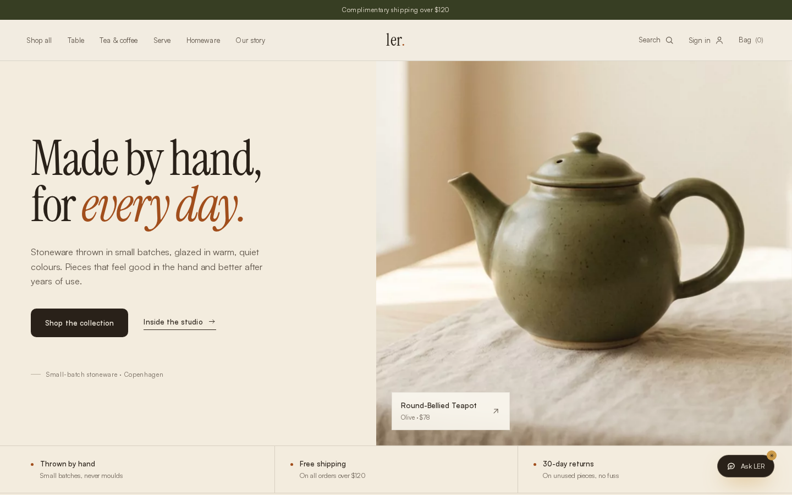
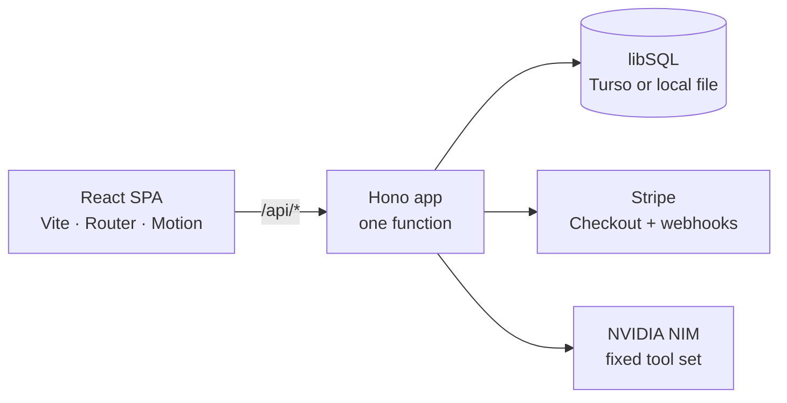

<div align="center">

<h1>ler.</h1>

<p><strong>A production-shaped storefront for a fictional Copenhagen stoneware studio.</strong></p>

<p>Real accounts, persisted orders, signed Stripe webhooks,<br>
and an assistant that cannot invent a product.</p>

<p>
  <a href="https://ler-gold.vercel.app"><strong>Live demo</strong></a>
  &nbsp;·&nbsp; <a href="#quickstart">Quickstart</a>
  &nbsp;·&nbsp; <a href="#architecture">Architecture</a>
  &nbsp;·&nbsp; <a href="SECURITY.md">Security</a>
</p>

<p>
  <a href="https://github.com/Chmgx81/ler-storefront/actions/workflows/ci.yml"></a>
  <a href="LICENSE"></a>
  
</p>



</div>

<br>

The point of this project is the shape, not the pottery. A shop needs more than a grid of cards: sessions that survive a reload, guest checkout that does not leak other people's orders, prices and stock the client cannot set, webhooks that cannot be replayed, an admin ledger, and an LLM with a fixed toolset. That is what is in here, at the size of one small codebase.

<table>
  <tr>
    <td width="50%"><br><sub><b>Shop</b> · filters, sort and search in the URL</sub></td>
    <td width="50%"><br><sub><b>Product</b> · gallery, options and assistant entry points</sub></td>
  </tr>
</table>

## Quickstart

Requires **Node 22.5+**.

```bash
npm install
cp .env.example .env          # set BETTER_AUTH_SECRET
openssl rand -base64 48       # paste the output into .env
npm run db:migrate
npm run dev                   # API :8787, storefront :5173
```

Open <http://localhost:5173>. No API keys are needed: the shop runs in demo mode, mail is written to `data/outbox`, and the assistant answers from the local catalogue.

```bash
npm test                      # 21 integration tests
npm run build && npm start    # production build on :8787
```

## What is here

| | |
|---|---|
| **Catalogue** | 16 pieces across Table, Tea & coffee, Serve and Homeware, with filters, sort and search |
| **Bag** | Local, survives reload, and checks out without an account |
| **Accounts** | Better Auth 1.7: sign-up, sign-in, reset, password change, session revocation, deletion |
| **Orders** | libSQL; prices, names, shipping and stock recomputed server-side |
| **Guest access** | An order is readable only with its own random token, never by UUID alone |
| **Payments** | Stripe hosted Checkout, signed webhooks, refunds. Demo mode by default |
| **Stock** | Reserved at checkout, committed on payment, released on expiry |
| **Admin** | `/admin` ledger for allowlisted **and verified** emails |
| **Assistant** | NVIDIA NIM tool calling over a fixed catalogue API, with a local fallback |
| **Accessibility** | axe clean across 25 desktop and mobile views, keyboard paths tested |

Deliberately absent: tax calculation, carrier rates, discount codes, product editing, partial refunds, dispute handling. Those are business decisions rather than missing components.

## Architecture



Two entry points share one app. Locally, `server/index.ts` runs Hono on `:8787` and serves `dist/`. On Vercel, `api/index.ts` delegates to the pre-bundled `dist-server/api-function.js`, because Vercel will not bundle local TypeScript imports from `api/`.

Data is **libSQL** either way: a file at `data/ler.sqlite` in development, [Turso](https://turso.tech) in production. One code path, no dialect split. Schema versions live in an `app_schema` table because Turso rejects `PRAGMA user_version`.

```
src/                 React 19 · React Router 7 · Motion · Vite 7
  data/products.ts   the catalogue, single source of product truth
  lib/pricing.ts     shared totals, so client and server cannot drift
  styles/global.css  every design token and component style
server/              Hono app, Better Auth, orders, stock, payments, assistant
tests/               node:test integration suites
cook/                design brief, round log, OWASP notes, a11y reports
```

## Payments

Demo mode is the default and says so: the confirmation states that no payment was taken. To switch to Stripe, set `PAYMENTS_MODE=stripe` with `STRIPE_SECRET_KEY`, `STRIPE_WEBHOOK_SECRET` and a public `BETTER_AUTH_URL`, then register the webhook for `checkout.session.completed`, `checkout.session.async_payment_succeeded`, `checkout.session.async_payment_failed`, `checkout.session.expired` and `charge.refunded`.

The flow: checkout creates an `awaiting_payment` order, reserves stock and redirects to Stripe-hosted Checkout. Card details never touch this app. The return route verifies the session with Stripe, and a signed webhook marks the order paid, commits stock and sends a receipt. Events are verified with a five-minute tolerance and recorded by event id, so redelivery cannot sell stock twice. A payment that lands after the hold expires is refunded automatically.

Production refuses to boot in demo mode unless `ALLOW_DEMO_PAYMENTS=true`, and refuses `PAYMENTS_MODE=stripe` without keys.

## Accounts and access

- Guests browse, add to the bag, check out and receive a receipt without signing in.
- A guest order is **not** attached to an account created later; that needs an explicit claim step.
- Admin is an allowlist, not a role table: `ADMIN_EMAILS` plus `REQUIRE_EMAIL_VERIFICATION=true`. The server will not start if admin access would rest on an unverified address.
- Password change revokes other sessions. Deletion removes the account, its orders and its subscription.

There are **no demo accounts in this repository**. Sign up, add that address to `ADMIN_EMAILS`, verify it, and restart.

## The assistant

A floating **Ask LER** panel is on every page, plus two entry points on a product: *"Ask the studio about this piece"* and *"Style it for me"*, which searches the catalogue and proposes a set with one-click add.

The key is server-side only and never appears in `/api/meta`, a response or a log. Tools are a fixed allowlist: `search_catalog`, `get_product`, `stock_status`, `suggest_add_to_cart`. Arguments are validated and results come only from the local catalogue. There is no browsing tool and no user-controlled URL to fetch, so there is no SSRF sink. Model output is treated as untrusted data; cards and buttons are built from validated slugs, so the assistant cannot invent a price or a link.

On error or timeout the reply falls back to local guidance with a visible notice. Muse Glimmer is a reasoning model, so expect 10–30s per tool round; set `NVIDIA_MODEL` to a faster NIM model if you want snappier replies.

## Design system

Tokens live at the top of `src/styles/global.css`.

- **Colour** in OKLCH, sampled from the photography: paper, ink, olive, rust, honey. One accent, alpha borders, no pure black or white.
- **Radii** nested rather than arbitrary: `--r-outer` for cards, `--r-inner` for what sits inside (outer minus padding), `--r-control` for inputs.
- **Type** self-hosted Instrument Serif for display, Satoshi for UI. Tabular numerals for prices, balanced headline wrapping.
- **Motion** from `scale: 0.97` on the spring token, press at `0.97`, a shake on a bad password, and a full `prefers-reduced-motion` path.
- **Photography** on paper uses `mix-blend-mode: multiply`, disabled under forced colours and dark mode.

## Verification

`npm test` runs 21 integration tests against throwaway databases: sessions and revocation, guest order tokens and UUID-only access being refused, server-side repricing, stock reserve and oversell refusal, webhook tampering and replay, refund transitions, per-IP limits, CSRF backstops, and an assistant tool loop that asserts the key never leaks.

`npm run build` typechecks the client and bundles the server. CI runs both on Node 22 and 24.

Browser checks were run with Playwright during development: axe-core reports for 25 views, a mobile audit at 360, 390 and 430, and end-to-end purchase, auth and keyboard flows. The results and the round-by-round reasoning are in [`cook/`](cook/).

## Deploy

Deployed on **Vercel** with **Turso**:

1. `vercel link`, then create a Turso database from the Vercel Marketplace.
2. Set `BETTER_AUTH_URL`, `BETTER_AUTH_SECRET`, `TRUST_PROXY=true` and `TRUSTED_ORIGINS`, plus Stripe and Resend keys for real commerce.
3. `npm run db:migrate` against the new database.
4. `vercel --prod`.

`vercel.json` builds the SPA into `dist/`, bundles the Hono app, and rewrites `/api/*` to the single function. Any Node host works too: `npm run build && npm start`.

<details>
<summary><b>Configuration</b></summary>

<br>

Every variable is documented in [`.env.example`](.env.example). The ones that change behaviour:

| Variable | Default | Effect |
|---|---|---|
| `BETTER_AUTH_SECRET` | required | Session signing. At least 32 characters in production |
| `BETTER_AUTH_URL` | `http://localhost:5173` | Public origin. Must be https in production |
| `PAYMENTS_MODE` | `demo` | `demo` takes no money; `stripe` uses hosted Checkout |
| `MAIL_MODE` | `auto` | `file` writes to `data/outbox`; `resend` sends real mail |
| `REQUIRE_EMAIL_VERIFICATION` | `false` | Required before admin access can be granted |
| `ADMIN_EMAILS` | empty | Comma-separated allowlist for `/admin` |
| `TRUST_PROXY` | `false` | Use `X-Forwarded-For` for rate limits, only behind your own proxy |
| `NVIDIA_API_KEY` | empty | Enables the model; unset uses local guidance |
| `DATABASE_PATH` | `data/ler.sqlite` | Ignored when `TURSO_DATABASE_URL` is set |

</details>

## Security and limits

Coverage against the OWASP Top 10 and the reasoning behind each control is in [`cook/OWASP.md`](cook/OWASP.md). Same-origin checks on writes, `HttpOnly`/`SameSite=Lax` cookies, CSP, HSTS, COOP, `Permissions-Policy`, `nosniff`, a 32 KB body limit and request IDs. Parameterised SQL throughout, database-backed per-IP limits, and secrets that are validated at startup and never sent to the client.

Report a vulnerability privately through [`SECURITY.md`](SECURITY.md), not the issue tracker.

Known limits:

- No tax calculation, per-country shipping rates or invoicing. Flat demo shipping, tax shown as included.
- No product, stock or discount editing UI.
- Full refunds only. No partial refunds, chargebacks or accounting export.
- No carrier integration, packing slips or fulfilment webhooks.
- Email change is not offered; name, password and deletion are self-service.
- One admin tier, defined by a verified email allowlist.

## Licence

Code is [MIT](LICENSE). Product photography, reference screenshots and both font families keep their own terms; [`LICENSE`](LICENSE) and [`public/fonts/LICENSE.md`](public/fonts/LICENSE.md) spell out what to replace before using this commercially.

<div align="center">
<br>
<sub>Built as a design and engineering exercise. The studio, the pieces and the copy are fictional.</sub>
</div>
