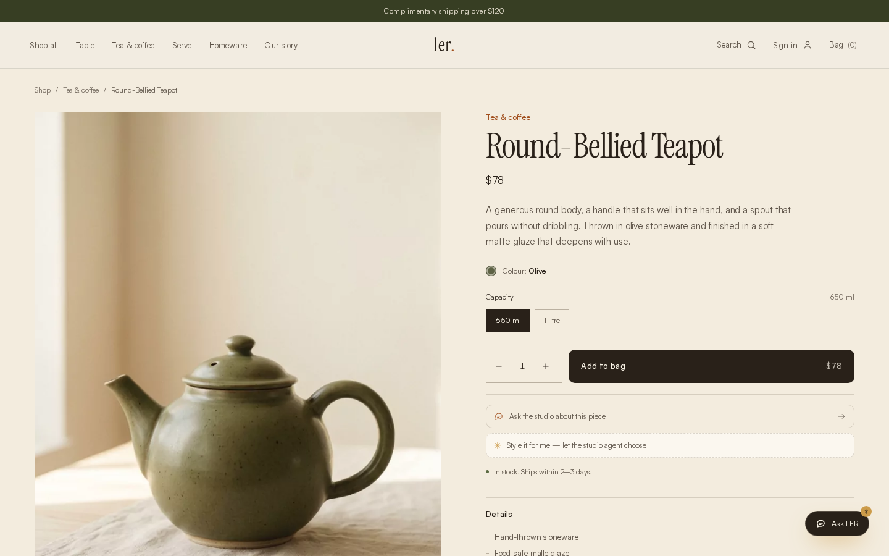
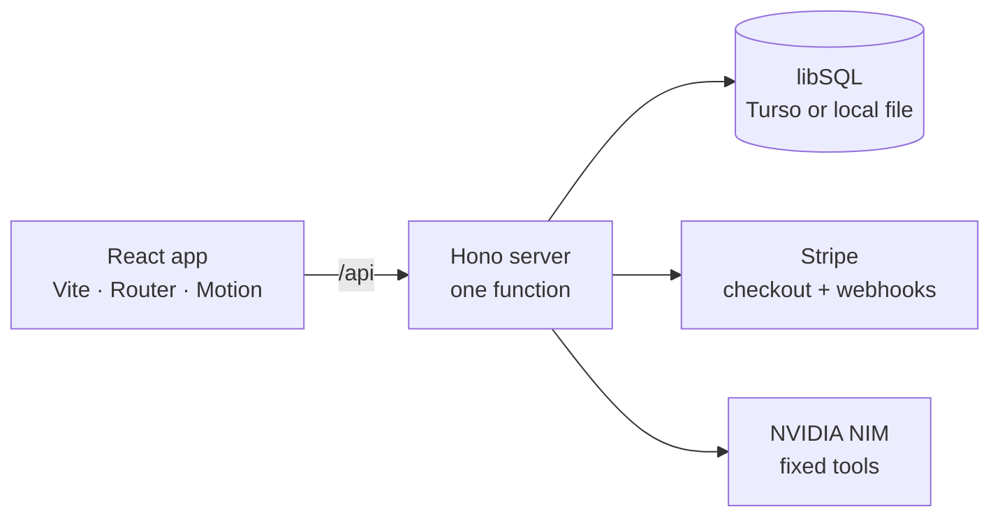

<div align="center">

<h1>ler.</h1>

<p><strong>A small, production-shaped storefront for a fictional stoneware studio.</strong></p>

<p>Real accounts, persisted orders, Stripe when you add keys,<br>
and an assistant that can search the shop but cannot invent a product.</p>

<p>
  <a href="https://ler-gold.vercel.app"><strong>Live demo</strong></a>
  &nbsp;·&nbsp; <a href="#quickstart">Quickstart</a>
  &nbsp;·&nbsp; <a href="SECURITY.md">Security</a>
  &nbsp;·&nbsp; <a href="LICENSE">Licence</a>
</p>

<p>
  <a href="https://github.com/Chmgx81/ler-storefront/actions/workflows/ci.yml"></a>
  <a href="LICENSE"></a>
  
</p>


</div>

<br>

Most storefront demos stop at a grid of cards. This one carries the parts that decide whether a shop works: guest checkout that does not leak other orders, prices the browser cannot set, webhooks that cannot be replayed, an admin ledger, and a fixed toolset for the assistant. Still one small codebase.

<table>
  <tr>
    <td width="50%"><br><sub><b>Shop</b> — filters, sort and search live in the URL</sub></td>
    <td width="50%"><br><sub><b>Product</b> — options, care notes and assistant entry points</sub></td>
  </tr>
</table>

## Quickstart

Needs **Node 22.5 or newer**. No accounts or keys to sign up for.

```bash
npm install
cp .env.example .env
openssl rand -base64 48        # paste into BETTER_AUTH_SECRET in .env
npm run db:migrate
npm run dev
```

Open **http://localhost:5173**. That is the whole setup. Demo mode charges no card, writes mail to `data/outbox`, and answers from the local catalogue.

```bash
npm test                      # 21 integration tests
npm run build && npm start    # production build on :8787
```

## What you get

- **Shop** — 16 pieces, four collections, filters, sort, search, quick add.
- **Bag** — survives a reload, checks out without an account.
- **Accounts** — sign up, sign in, reset, change password, delete.
- **Orders** — stored in SQLite or Turso, repriced on the server.
- **Guest receipts** — readable only with their own random token.
- **Payments** — Stripe Checkout and signed webhooks, or honest demo mode.
- **Stock** — reserved, committed, released.
- **Admin** — `/admin` ledger for allowlisted, verified emails.
- **Assistant** — proposes pieces from the catalogue, never a made-up price.
- **Accessible** — axe clean across 25 views, keyboard paths tested.

## How it works



- **Two entry points, one app.** `server/index.ts` for a Node host, `api/index.ts` for Vercel.
- **Two databases, one client.** A local file in development, Turso in production.
- **One pricing module.** `src/lib/pricing.ts` is shared, so client and server cannot drift.
- **One stylesheet.** Every token and component rule is in `src/styles/global.css`.

```
src/     React 19 · React Router 7 · Motion · Vite 7
server/  Hono · Better Auth · orders · stock · payments · assistant
tests/   node:test integration suites
cook/    design brief, round log, OWASP notes, a11y reports
```

## Configure

Everything is in [`.env.example`](.env.example). The ones that change behaviour:

| Variable | Default | What it does |
|---|---|---|
| `BETTER_AUTH_SECRET` | required | Signs sessions |
| `PAYMENTS_MODE` | `demo` | `stripe` switches to Checkout |
| `MAIL_MODE` | `auto` | `resend` sends real email |
| `ADMIN_EMAILS` | empty | Who can open `/admin` |
| `TRUST_PROXY` | `false` | Read `X-Forwarded-For`, only behind your own proxy |
| `NVIDIA_API_KEY` | empty | Adds the model; unset uses local answers |

## Ship it

<details>
<summary><b>Take real payments</b></summary>
<br>

Set `PAYMENTS_MODE=stripe`, `STRIPE_SECRET_KEY` and `STRIPE_WEBHOOK_SECRET`, then point Stripe at `https://your-shop.example/api/payments/stripe/webhook` for `checkout.session.completed`, `checkout.session.async_payment_succeeded`, `checkout.session.async_payment_failed`, `checkout.session.expired` and `charge.refunded`.

Card details never touch the app. A payment that arrives after the stock hold expires is refunded. Test with `4242 4242 4242 4242` first.

</details>

<details>
<summary><b>Deploy to Vercel</b></summary>
<br>

1. `vercel link`, then create a Turso database from the Vercel Marketplace.
2. Set `BETTER_AUTH_URL`, `BETTER_AUTH_SECRET` and `TRUST_PROXY=true`.
3. `npm run db:migrate` against the new database.
4. `vercel --prod`.

`vercel.json` bundles the server into one function and routes `/api/*` to it. Any Node host works too: `npm run build && npm start`.

</details>

## Security

Same-origin checks, `HttpOnly` and `SameSite=Lax` cookies, CSP, HSTS, a 32 KB body limit, parameterised SQL, database-backed rate limits, and secrets that never reach the browser. The assistant has no browsing tool, so there is no URL for a user to point it at.

Coverage is in [`cook/OWASP.md`](cook/OWASP.md). Report vulnerabilities privately via [`SECURITY.md`](SECURITY.md). Known limits: no tax or live shipping rates, no product editing, full refunds only, one admin tier.

## Licence

Code is [MIT](LICENSE). Product photography and both fonts keep their own terms; see [`LICENSE`](LICENSE) and [`public/fonts/LICENSE.md`](public/fonts/LICENSE.md) for what to replace before selling anything.

<div align="center">
<br>
<sub>Built as a design and engineering exercise. The studio, the pieces and the copy are fictional.</sub>
</div>
