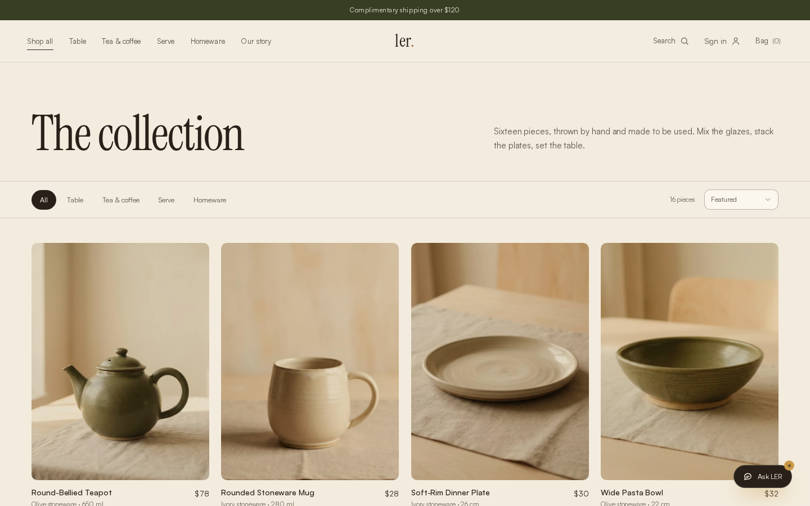

# LER

A small, production-shaped storefront for a fictional Copenhagen stoneware
studio. Real accounts, real persisted orders, an agentic assistant — and, when
configured, real card payments through Stripe Checkout. It runs in demo mode by
default and takes no money.

The point of the project is the shape, not the pottery: a single small codebase
that shows what a shop needs beyond a grid of cards — sessions, guest orders,
server-owned prices and stock, signed webhooks, rate limits, an admin ledger, an
LLM that cannot invent a product, and an accessible UI that holds up on a phone.

**[Live demo](https://ler-gold.vercel.app)** · runs with demo payments and a
file-based mail outbox.

<picture>
  <source media="(max-width: 700px)" srcset="docs/home-mobile.png">
  
</picture>

<table>
  <tr>
    <td></td>
    <td></td>
  </tr>
</table>

## Contents

- [Run it](#run-it)
- [What is actually implemented](#what-is-actually-implemented)
- [Architecture](#architecture)
- [Taking real money](#taking-real-money)
- [Accounts and access](#accounts-and-access)
- [The assistant](#the-assistant)
- [Design system](#design-system)
- [Tests](#tests)
- [Deploying](#deploying)
- [Security](#security)
- [Limitations](#limitations)
- [Licence](#licence)

## Run it

Requires **Node 22.5+**.

```bash
npm install
cp .env.example .env          # then set BETTER_AUTH_SECRET
openssl rand -base64 48       # paste the output into BETTER_AUTH_SECRET
npm run db:migrate
npm run dev                   # API :8787, storefront :5173
```

Open <http://localhost:5173>. The API and the Vite dev server run together; Vite
proxies `/api`.

```bash
npm test                      # 21 integration tests, throwaway databases
npm run build && npm start    # production build on :8787
```

Nothing else is required. Without a mail provider, verification and reset
messages are written as JSON files to `data/outbox` — the UI does not pretend an
email was sent. Without an NVIDIA key the assistant answers from the local
catalogue.

## What is actually implemented

This is the part worth checking before you reuse anything.

| Area | Behaviour |
|---|---|
| Catalogue | 16 pieces across Table, Tea & coffee, Serve and Homeware; filters, sort, full-text search |
| Bag | Local, survives reload; guest checkout without an account |
| Accounts | Better Auth 1.7: sign-up, sign-in, reset, password change, session revocation, deletion |
| Orders | Persisted in libSQL; prices, names, shipping and stock recomputed server-side |
| Guest access | Order reachable only with a separate random token, never by UUID alone |
| Payments | Stripe hosted Checkout, signed webhooks, refunds; demo mode otherwise |
| Stock | Reservation on checkout, commit on payment, release on expiry or cancellation |
| Admin | `/admin` ledger for allowlisted **and verified** emails: status changes, demo refunds |
| Assistant | NVIDIA NIM tool-calling agent over a fixed catalogue API, with a local fallback |
| A11y | axe clean across 25 desktop and mobile views; keyboard paths tested |

Deliberately absent: tax calculation, carrier rates, discount codes, product
editing, partial refunds, dispute handling. Those are business decisions, not
missing components — see [Limitations](#limitations).

## Architecture

```
src/                 React 19 + React Router 7 + Motion, Vite 7
  data/products.ts   the catalogue; the single source of product truth
  lib/pricing.ts     shared client/server totals so they cannot drift
  styles/global.css  all design tokens and component styles
  pages/             home, shop, product, checkout, confirmation, account, admin, legal
server/
  app.ts             Hono app: middleware, routes, static serving
  auth.ts            Better Auth + libSQL/Kysely adapter
  config.ts          fail-fast environment validation
  orders.ts          order creation, listing, admin routes, rate limits
  stock.ts           reserve / commit / release
  order-status.ts    idempotent paid → packed → shipped → refunded transitions
  payments.ts        Stripe REST calls and webhook signature verification
  payment-routes.ts  webhook endpoint and payment return
  assistant.ts       NIM tool loop, model output treated as untrusted
  db.ts              libSQL client, versioned schema, stock seed
api/index.ts         the single Vercel Function that delegates /api/*
tests/               node:test integration suites
cook/                design brief, round log, OWASP notes, a11y reports
```

Two entry points share one app:

- **Local** — `server/index.ts` runs Hono on `:8787` and serves `dist/`.
- **Vercel** — `api/index.ts` imports the pre-bundled `dist-server/api-function.js`.
  Vercel does not bundle local TypeScript imports from `api/`, so `npm run build`
  compiles the server first.

Data is **libSQL** in both cases: a local file at `data/ler.sqlite` in
development, [Turso](https://turso.tech) when `TURSO_DATABASE_URL` is set. One
code path, no dialect split. Schema versioning uses an `app_schema` table
because Turso rejects `PRAGMA user_version`.

## Taking real money

Demo mode is the default and is honest about it: the confirmation says no payment
was taken and no order will ship.

To switch to Stripe:

1. Set `PAYMENTS_MODE=stripe`, `STRIPE_SECRET_KEY` and `STRIPE_WEBHOOK_SECRET`.
2. Register `https://your-shop.example/api/payments/stripe/webhook` for:
   `checkout.session.completed`, `checkout.session.async_payment_succeeded`,
   `checkout.session.async_payment_failed`, `checkout.session.expired`,
   `charge.refunded`.
3. Set `BETTER_AUTH_URL` to the public https origin and add `RESEND_API_KEY` for
   receipts.
4. Test in Stripe test mode with `4242 4242 4242 4242` before going live.

The flow: checkout creates an `awaiting_payment` order, reserves stock and
redirects to Stripe-hosted Checkout. Card details never touch this app. The
return route verifies the session with Stripe; a signed webhook marks the order
paid, commits stock and sends a receipt. Webhook events are verified with a
5-minute tolerance and recorded by event id, so a redelivery cannot sell stock
twice. A payment that lands after the hold expires is refunded automatically.

Production refuses to start in demo mode unless `ALLOW_DEMO_PAYMENTS=true`, and
refuses `PAYMENTS_MODE=stripe` without keys.

## Accounts and access

- Guests browse, add to the bag, check out and receive a receipt without signing
  in. A guest order carries `user_id = NULL` and is read with a random access
  token from the receipt link.
- A guest order is **not** retroactively attached to an account created later;
  that needs an explicit claim step.
- Admin is an allowlist, not a role table: `ADMIN_EMAILS` plus
  `REQUIRE_EMAIL_VERIFICATION=true`. The server refuses to boot if admin access
  would rest on an unverified email.
- Password change revokes other sessions. Account deletion removes the account,
  its orders and its newsletter subscription.

There are **no demo accounts in this repository**. To create an admin, sign up
normally, set `ADMIN_EMAILS` to that address, mark the row verified (or complete
verification with a real mail provider) and restart.

## The assistant

A floating **Ask LER** chat is on every page, plus product-level entry points:
*"Ask the studio about this piece"* and *"Style it for me"*, which searches the
catalogue and proposes a set with one-click add.

```env
NVIDIA_API_KEY=nvapi-...
NVIDIA_MODEL=meta/muse-glimmer-30b
NVIDIA_BASE_URL=https://integrate.api.nvidia.com/v1
ASSISTANT_RATE_MAX=20
ASSISTANT_MAX_TOOL_ROUNDS=2
```

- The key is server-side only and never appears in `/api/meta`, responses or logs.
- Tools are a fixed allowlist — `search_catalog`, `get_product`, `stock_status`,
  `suggest_add_to_cart`. Arguments are validated and results come only from the
  local catalogue. There is no browsing tool and no user-controlled URL to fetch,
  so there is no SSRF sink.
- Tool output and user messages are untrusted data, not instructions. Cards and
  add-to-bag buttons are built from validated slugs; the model cannot invent a
  price or a link.
- Upstream calls have a timeout, redirects disabled, a response size cap and a
  bounded tool loop. Messages are capped by turn and length.
- On error or timeout the reply falls back to local guidance with a visible note.
- Muse Glimmer is a reasoning model: expect roughly 10–30s per tool round. Set
  `NVIDIA_MODEL` to a faster NIM model for snappier replies; the loop and UI are
  model-agnostic.

## Design system

Tokens live at the top of `src/styles/global.css`:

- **Colour** in OKLCH — paper, ink, olive, rust, honey — sampled from the
  photography, with one accent (`--accent: var(--honey)`) and alpha borders.
- **Radii** nested, not arbitrary: `--r-outer` for cards, `--r-inner` for what
  sits inside (outer minus padding), `--r-control` for inputs and buttons.
- **Type** self-hosted Instrument Serif for display, Satoshi for UI. Prices use
  tabular numerals; headlines balance their wrapping.
- **Motion** from `scale: 0.97` with a spring token, press at `0.97`, a shake on
  a bad password, and a full `prefers-reduced-motion` path.
- **Photography** on paper uses `mix-blend-mode: multiply` so the surface shows
  through, disabled under forced colours and dark mode.

## Tests

```bash
npm test        # 21 integration tests
npm run build   # typecheck client + bundle server
```

The suites (`tests/*.test.mjs`) run against throwaway databases and cover:

- sign-up, sign-in, session reads, password change and revocation
- guest order creation, token-gated reads, and UUID-only access being refused
- server-side repricing and rejection of over-long or invalid input
- stock reserve → commit → release, and oversell refusal
- webhook signature verification, tampering, replay, refund transitions
- per-IP rate limits and CSRF backstops
- assistant fallback, rate limiting, and a fake-NIM tool loop that asserts the
  key never leaks into a response

Browser checks (axe, mobile audit, purchase flow) were run with Playwright during
development and their results are recorded in `cook/`. They are not part of
`npm test` because they need a running server and a browser.

## Deploying

The app is deployed on **Vercel** with **Turso** for data:

1. `vercel link`, then create a Turso database from the Vercel Marketplace.
2. Set `BETTER_AUTH_URL`, `BETTER_AUTH_SECRET`, `TRUST_PROXY=true`,
   `TRUSTED_ORIGINS` and — for real commerce — the Stripe and Resend keys.
3. `npm run db:migrate` against the new database.
4. `vercel --prod`.

`vercel.json` builds the SPA into `dist/`, bundles the Hono app to
`dist-server/api-function.js`, and rewrites `/api/*` to the single function.
`TRUST_PROXY=true` makes rate limits use `x-forwarded-for`; only enable it behind
a proxy you control.

Any Node host works too: `npm run build && npm start` serves `dist/` plus `/api`
from one process. The reasoning behind each of these choices is recorded in
[`cook/ROUNDS.md`](cook/ROUNDS.md).

## Security

Coverage against the OWASP Top 10 and the reasoning behind each control is in
[`cook/OWASP.md`](cook/OWASP.md). In short:

- Same-origin checks on writes, `HttpOnly`/`SameSite=Lax` cookies, `Secure` on
  https, CSP, HSTS, COOP, `Permissions-Policy`, `nosniff`, a 32 KB body limit and
  request IDs.
- Parameterised SQL everywhere; no string-built queries.
- Database-backed per-IP limits on sign-in, sign-up, reset, orders and
  newsletter; forwarded headers ignored unless explicitly trusted.
- Secrets come from the environment, are validated at startup, and are never
  included in client responses.
- The assistant cannot reach the network on a user's behalf and cannot widen its
  own tool set.

Found something? Please follow [`SECURITY.md`](SECURITY.md) and report it
privately rather than in an issue.

## Limitations

- No tax calculation, per-country shipping rates or invoicing. Totals use flat
  demo shipping (free over $120) with tax shown as included.
- No product, stock or discount editing UI; no replenishment.
- Full refunds only. No partial refunds, chargeback handling or accounting export.
- No carrier integration, packing slips or fulfilment webhooks.
- Email change is not offered; name, password and deletion are self-service.
- One admin tier, defined by a verified email allowlist.
- Photography is third-party demo content — see [`LICENSE`](LICENSE).

## Licence

Code is [MIT](LICENSE). Product photography, reference screenshots and the two
font families keep their own terms; the licence file and
[`public/fonts/LICENSE.md`](public/fonts/LICENSE.md) spell out what you must
replace before using this commercially.
